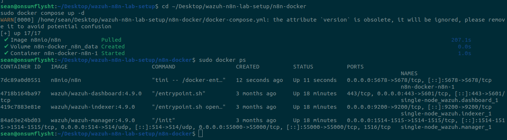
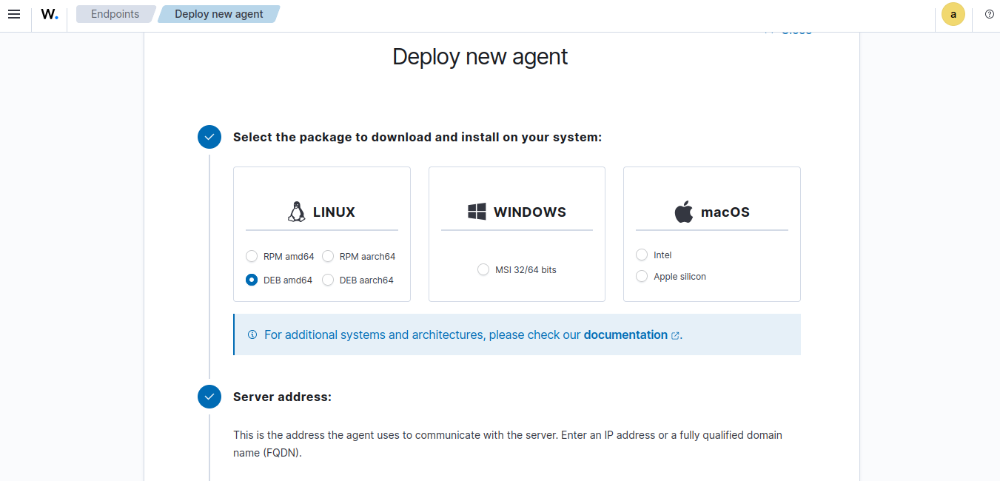
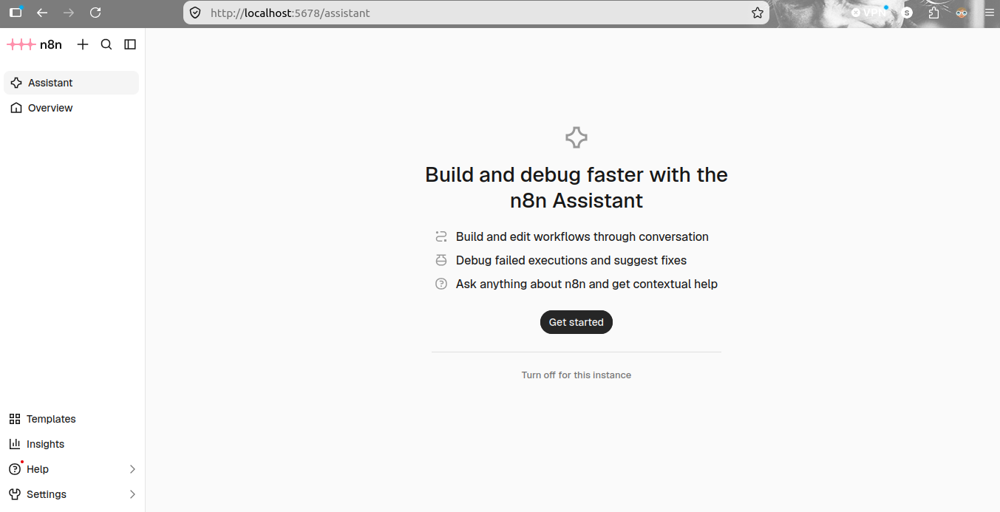

# 00. Lab setup

Status: Complete

## Objective

Set up a local Ubuntu environment running Wazuh and n8n in Docker, connected through a shared network.

## Environment

| Item | Configuration |
|---|---|
| Host | MacBook Pro |
| Virtualisation | VirtualBox |
| Operating system | Ubuntu 22.04 |
| Docker | 29.9.3 |
| Wazuh | 4.9.0 |
| n8n | `n8nio/n8n` |
| Docker network | `soc-net` |

## Build

The Docker daemon initially failed to start because its systemd socket was in a failed state. I recovered the socket and service using systemd.

An existing Wazuh 4.9.0 deployment was already installed. I retained its Manager, Indexer and Dashboard containers rather than replacing them with a different version.

The n8n Compose configuration required an external `soc-net` network. I created the network, connected the three Wazuh containers and started n8n.

The resulting environment had four running containers:

- Wazuh Manager
- Wazuh Indexer
- Wazuh Dashboard
- n8n

## Evidence

**Docker containers running**

**Wazuh agent management**

**n8n initial setup**

## Outcome

The local Wazuh and n8n environment is running, the dashboards are accessible, and all four containers are connected through the shared Docker network.

## Next stage

[Stage 01: Wazuh and n8n architecture](lesson-01-wazuh-n8n-architecture.md)
