# Stage 08: Attack chain investigation

<sup>Status: Complete for the current web attack investigation scope</sup>

**Masterclass reference:** Lesson 6

## Objective

Simulate a controlled web attack from a separate Kali attacker container, trace the resulting activity through Apache and Wazuh, and build a custom detection for command parameter access.

The investigation focuses on the web attack path available in the current local environment. Windows credential attacks, lateral movement and a separate Linux privilege escalation target are documented as possible future expansions.

## Lab environment

The Ubuntu 22.04 virtual machine hosts the security stack and the vulnerable web application. Kali runs as a separate Docker container on an isolated Docker network.

| Component | Role |
|---|---|
| Ubuntu 22.04 | Hosts Wazuh and Docker |
| Kali attacker container | Performs reconnaissance and controlled web testing |
| Vulnerable web application | PHP 8.2 and Apache application with a deliberate command injection flaw |
| Wazuh Agent 007 | Collects host and Docker application logs |
| Wazuh Manager and Indexer | Analyse and store telemetry and alerts |
| Wazuh Dashboard | Supports threat hunting and event investigation |

The attacker container used address `172.20.0.3` on `attack-net`. The vulnerable web application used address `172.20.0.2` on the same network. The application container was also attached to the Docker network used by the host logging setup.

The application runs with resource limits, a read-only application mount and Docker's `no-new-privileges` setting. It is a deliberately vulnerable lab target and is not intended for exposure to an untrusted network.

## Reconnaissance

The Kali container was used to identify and assess the web service.

| Tool | Activity | Result |
|---|---|---|
| Nmap | TCP service discovery and HTTP enumeration | Port 80 identified as Apache HTTP |
| Nikto | Web server assessment | Reported missing security headers and version related observations for further review |
| GoSpider | Link and page crawling | No additional crawlable pages identified |
| FFUF | Query parameter discovery | Identified `cmd` as a parameter with a distinct response size |

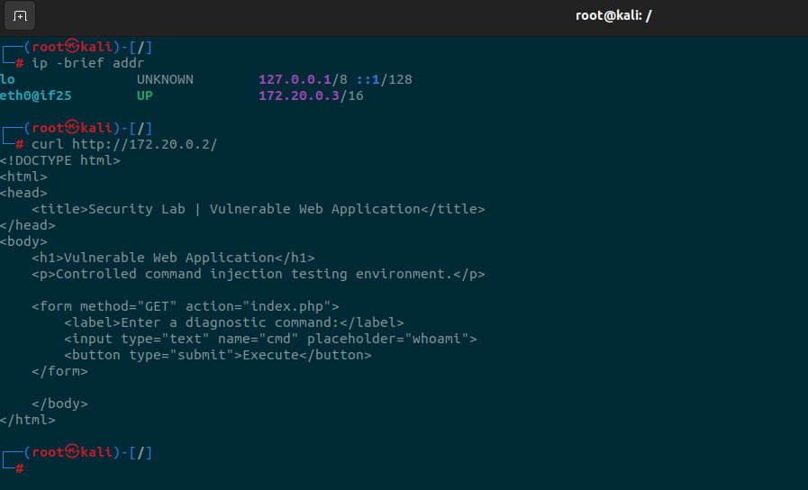

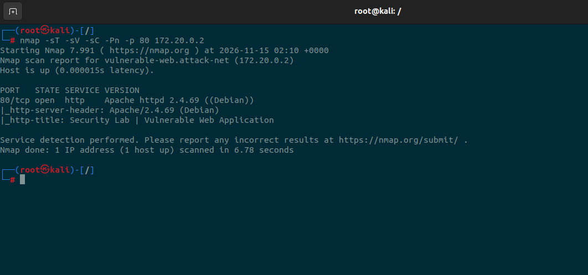

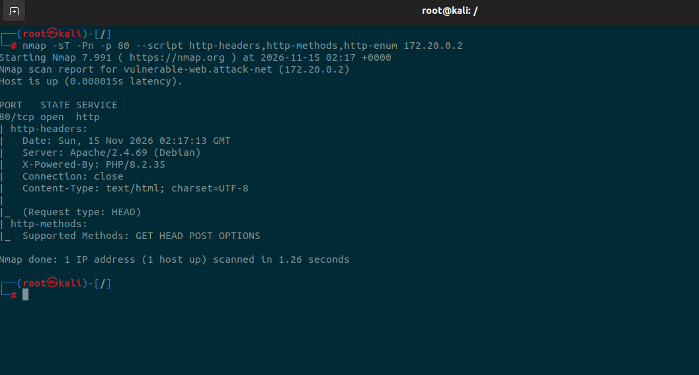

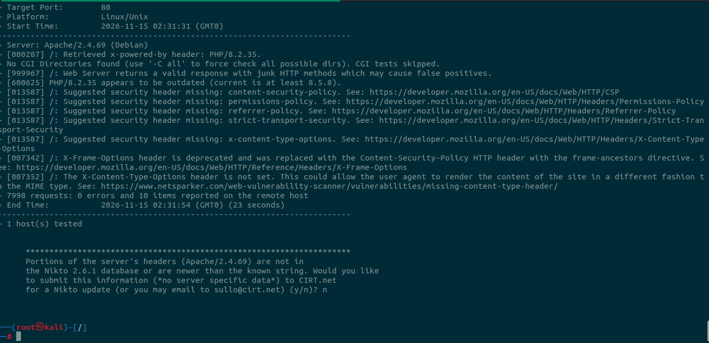

Nikto findings were treated as assessment observations, not as confirmed exploitable vulnerabilities. The GoSpider result reflected the limited single page application surface.

## Command injection validation

The application accepts a GET parameter named `cmd` and passes its value to a system command. Requests from Kali confirmed that commands executed inside the application container.

| Command | Observed output | Finding |
|---|---|---|
| `whoami` | `www-data` | Execution as the web server account |
| `id` | UID 33 and GID 33, both `www-data` | Confirms the execution identity |
| `hostname` | `f351e8da2087` | Identifies the application container |
| `uname -a` | Linux kernel and architecture details | Reveals container runtime system information |

The results demonstrate command execution inside the vulnerable application container. They do not demonstrate root access or compromise of the Ubuntu host.

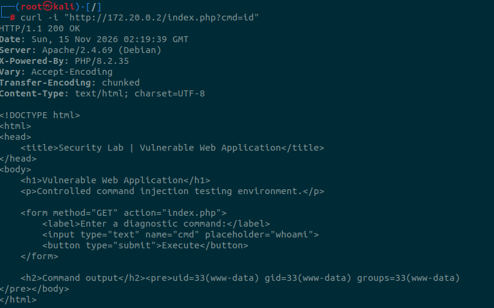

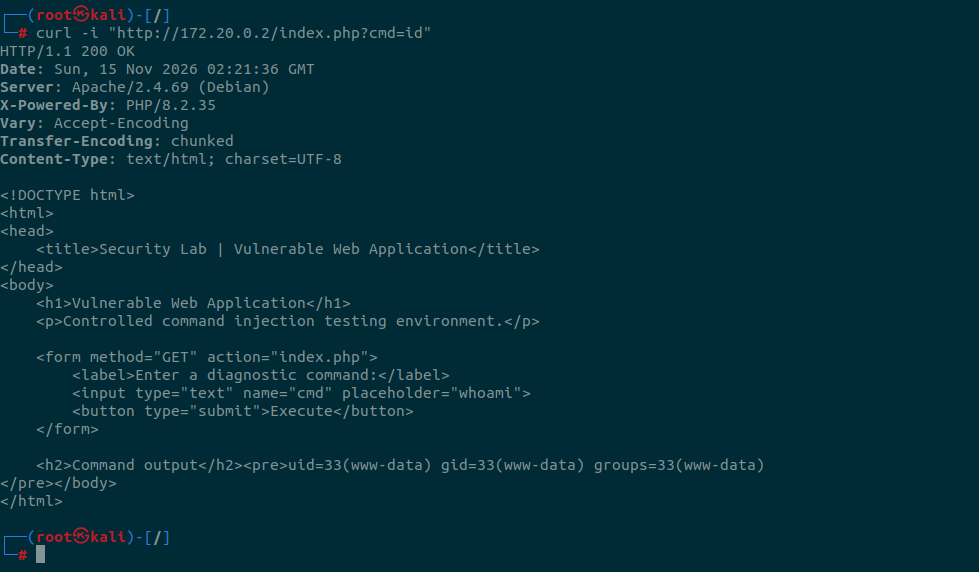

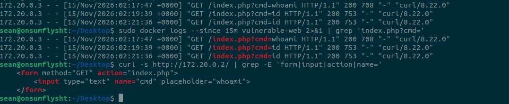

## SUID and container boundary inspection

The attacker used the command injection point to enumerate SUID files and inspect selected binary permissions. The enumeration returned standard system binaries including `su`, `passwd`, `mount` and `umount`.

The process security status was then inspected through `/proc/self/status`. The observed values included:

| Field | Observed value | Interpretation |
|---|---|---|
| UID | 33 | Process runs as `www-data` |
| `CapEff` | `0000000000000000` | No effective Linux capabilities |
| `CapPrm` | `0000000000000000` | No permitted capabilities |
| `NoNewPrivs` | `1` | The process cannot gain additional privileges through exec |
| `Seccomp` | `2` | Seccomp filtering is active |

This confirmed that the application process runs with a restricted privilege boundary. No privilege escalation was performed. The Ubuntu orchestrator was not modified with a SUID Python configuration because it also hosts the security stack.


## Apache telemetry and Wazuh ingestion

Apache access records were written to the application container's Docker JSON log. Wazuh Agent 007 collected the host Docker log, and the events were forwarded through the Wazuh Manager and Filebeat to the Indexer.

The Apache records included:

- Kali source address `172.20.0.3`.
- Request paths and query parameters.
- Request timestamps.
- HTTP response codes.
- User agent strings.

The events were visible in the `wazuh-archives-*` data view. The relevant records used the JSON decoder and identified the Docker JSON log as their source.

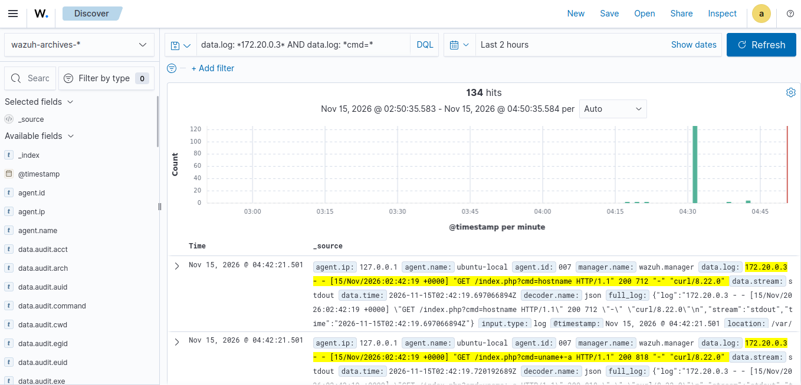

The verified telemetry path:

```text
Kali attacker container
  -> Vulnerable PHP application
  -> Apache access log
  -> Docker JSON log
  -> Wazuh Agent 007
  -> Wazuh Manager
  -> Filebeat
  -> Wazuh Indexer
  -> Wazuh Dashboard
```

## Custom detection engineering

A local Wazuh rule was added to `local_rules.xml`:

| Field | Value |
|---|---|
| Rule ID | `100100` |
| Level | 8 |
| Description | Web application command parameter accessed |
| Match | Requests containing `GET /index.php?cmd=` |
| Group | `web_attack_surface` |

The rule was tested with `wazuh-logtest` before the Manager was restarted. A live request then generated a Level 8 alert, which was confirmed first in the Manager's `alerts.json` file and then in the Indexer and Wazuh Threat Hunting.


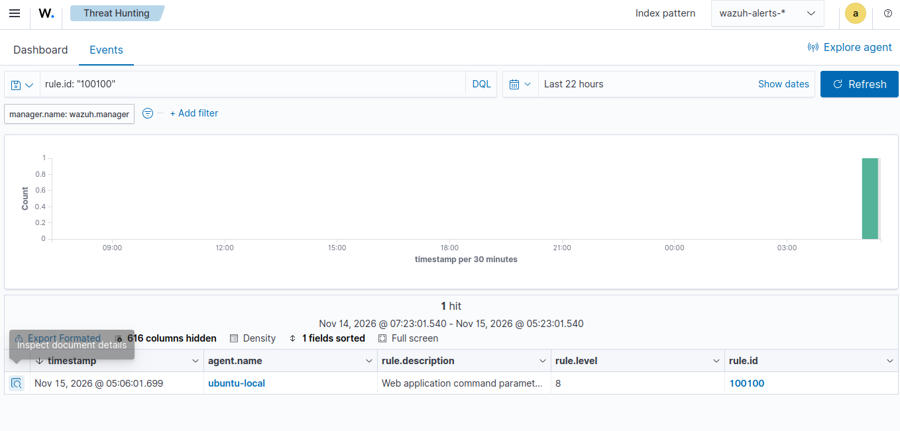

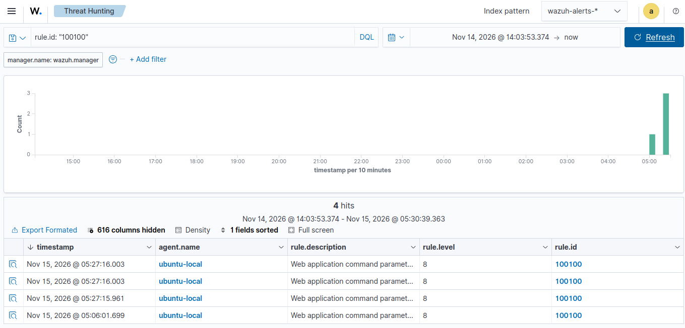

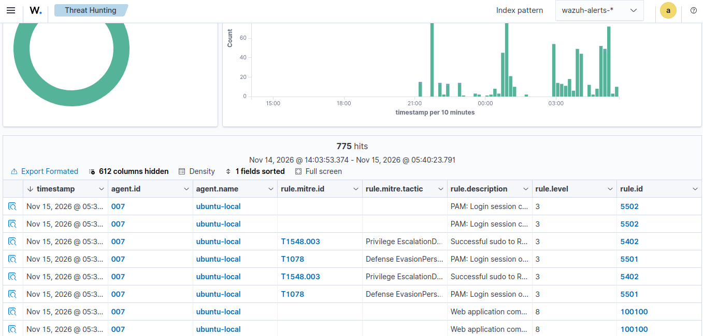


Eight matching custom alerts were visible during the investigation. The rule detects use of the application's command parameter. It does not determine whether a command is malicious, prove privilege escalation, or independently identify a specific MITRE ATT&CK technique. No MITRE mapping was assigned to this custom rule.

The broader Wazuh search also displayed existing sudo and PAM alerts with MITRE mappings. Those events related to host administration activity and were not treated as evidence of Kali privilege escalation.

## Investigation findings

- Kali discovered the Apache web service and identified the `cmd` query parameter.
- Command injection was confirmed through the application's response.
- Commands executed as `www-data` inside the application container.
- SUID enumeration identified standard SUID binaries.
- Container process status confirmed zero effective and permitted capabilities, `NoNewPrivs=1` and active seccomp filtering.
- Apache access records preserved the Kali source address, request, timestamp and response code.
- Wazuh collected and indexed the application telemetry.
- Custom rule `100100` generated Level 8 alerts for command parameter requests.

## Limitations and future expansion

This stage covers the web attack and its investigation path. It does not include:

- RDP credential attacks against a Windows endpoint.
- SSH pivoting or lateral movement.
- A reverse shell.
- Privilege escalation on a separate Linux target.
- Compromise of the Ubuntu host.

These scenarios can extend the lab later if additional endpoint resources become available. A Windows endpoint with Sysmon would add Windows process and authentication telemetry. A disposable Linux target would allow privilege escalation exercises without changing the Ubuntu machine that hosts Wazuh and n8n.

The current investigation remains useful without those extensions because the web attack, container execution context, telemetry flow and custom detection have all been exercised and verified.

## Outcome

The current web attack investigation scope is complete. Reconnaissance, command injection, SUID enumeration, container boundary inspection, Wazuh log ingestion and custom alert generation have been demonstrated.

The collected telemetry and alerts provide the investigation data for Stage 09, where the AI Threat Hunter will retrieve evidence, correlate related events and produce an analyst focused report.

## Next stage

[Stage 09: AI threat hunter](lesson-09-ai-threat-hunter.md)
