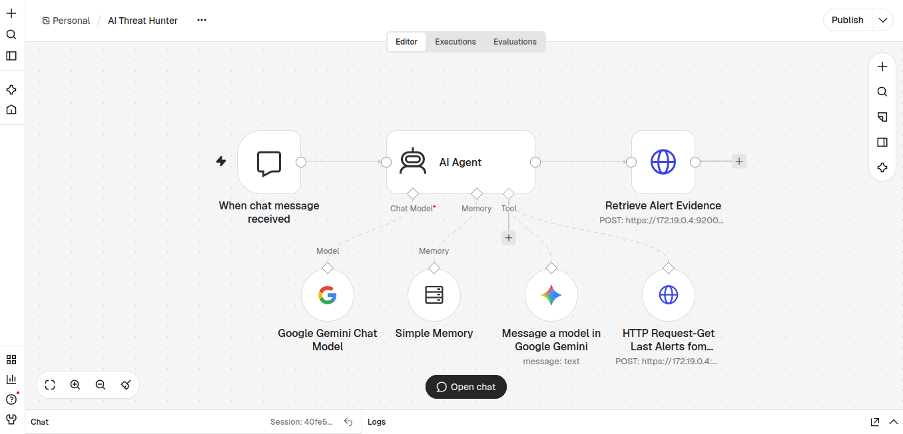
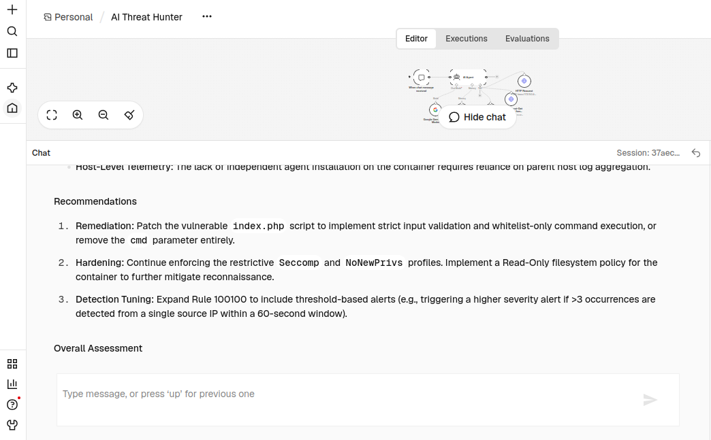

# Stage 09: AI threat hunter

Status: Complete for the current AI-assisted investigation scope

## Objective

Build an AI-assisted threat hunting workflow that retrieves Wazuh security data, accepts investigation questions through n8n, and produces structured findings with supporting evidence, MITRE ATT&CK context, evidence gaps and remediation recommendations.

The goal was to make the agent useful as an investigation assistant. It should interpret an analyst's question, examine the available security data and return a concise report. It must distinguish retrieved telemetry from scenario context supplied to the model and avoid presenting assumptions as confirmed findings.

## Architecture

The workflow was built in n8n using an AI Agent connected to Google Gemini 2.5 Flash. The agent receives analyst questions through the chat interface and uses an HTTP Request tool to query the Wazuh Indexer API.

| Component | Role |
|---|---|
| n8n Chat Trigger | Receives investigation questions |
| n8n AI Agent | Interprets the request and prepares an investigation response |
| Google Gemini 2.5 Flash | Analyses the retrieved information and produces the report |
| HTTP Request tool | Sends search requests to the Wazuh Indexer API |
| Wazuh Indexer | Provides access to indexed Wazuh alerts and security events |
| Conversation memory | Retains conversational context during the investigation |

The workflow keeps the analyst in control. The agent is used to investigate and summarise information. It does not automatically isolate endpoints, modify configurations, disable accounts or perform remediation actions.

## Agent configuration

The agent was configured for SOC threat hunting and DFIR analysis. Its instructions define how it should investigate suspicious activity, correlate related events, identify affected systems and accounts, and present evidence-based conclusions.

The prompt also sets boundaries for the investigation:

- Separate confirmed telemetry from contextual information supplied to the agent.
- Distinguish attempted activity from successful execution or compromise.
- Avoid inventing event details, timestamps, users, commands or indicators.
- Identify evidence gaps and state when the available data cannot support a conclusion.
- Include relevant Wazuh detections and MITRE ATT&CK mappings where supported.
- Provide practical remediation recommendations without claiming that actions were performed.

The agent is designed to return an analyst-focused report rather than a generic explanation of security concepts.

## Investigation workflow

The agent was tested with investigation questions covering different parts of the attack lifecycle. These included suspicious activity across monitored systems, command execution, initial access, post-compromise activity and correlation of the available findings.

The questions were designed to make the agent examine the available information from different investigative angles rather than return the same generic summary each time.

The resulting investigations covered:

- Suspicious activity and potential compromise.
- Command execution and privilege-related activity.
- Initial access through the vulnerable web application.
- Post-compromise discovery and security boundary inspection.
- Correlation of the attack activity into a consolidated assessment.

## Wazuh evidence and investigation context

The investigation used the Wazuh data generated during the previous endpoint telemetry and attack-chain stages. This included the custom web application detection, Rule ID `100100`, which identifies requests accessing the vulnerable application's `cmd` parameter.

During the documented investigation, eight matching Rule 100100 alerts were observed. The rule is a Level 8 detection named `Web application command parameter accessed`. It identifies access to the command parameter. It does not independently prove that every requested command executed successfully or that privilege escalation occurred.

The Indexer query also returned aggregate results for the endpoint. One observed response reported 38 matching records for `ubuntu-local`, comprising 30 records titled `Auditd: Device enables promiscuous mode.` and eight records titled `Web application command parameter accessed`. That response returned aggregation buckets but no individual event documents. The two finding types were therefore kept separate and the promiscuous-mode alerts were not treated as part of the web attack without corroborating evidence.

The agent's investigation also used scenario context describing the previously verified web attack path. This context included the Kali source, vulnerable application, command execution identity and container security settings documented in Stage 08. These details help the model interpret the investigation, but they are not equivalent to independently retrieved fields from every Wazuh alert.

This distinction is important: the agent combines available indexed data with supplied investigation context. Its report must not imply that contextual details were independently confirmed by the Indexer when the query did not return the underlying event documents.

## MITRE ATT&CK mapping

The agent was instructed to include MITRE ATT&CK techniques only where the observed activity supports the mapping. For the web attack investigation, the relevant areas included exploitation of a public-facing application, command execution and system or file discovery.

A technique being considered during an investigation does not mean that the technique was successfully completed. For example, SUID file enumeration does not establish privilege escalation. The investigation did not demonstrate container escape, compromise of the Ubuntu host, persistence, credential theft or successful lateral movement.

## Evidence gaps and remediation

The agent was also asked to identify what could not be established from the available information. This is important because the Indexer query did not always return individual event documents or all fields needed to independently reconstruct each command execution.

The investigation therefore retained the following boundaries:

- Rule 100100 confirms access to the application's command parameter, not the successful execution of every command.
- The documented command execution context was `www-data` inside the vulnerable application container.
- The observed process security settings showed `NoNewPrivs=1`, seccomp filtering enabled and no effective or permitted Linux capabilities.
- No evidence established container escape, Ubuntu host compromise, persistence, credential theft or lateral movement.
- Aggregate Indexer results were not treated as substitutes for individual event evidence.

Recommendations focused on removing the command injection flaw, preventing untrusted input from reaching shell commands, restricting application privileges, retaining useful application and endpoint telemetry, and reviewing related detections.

## Consolidated investigation report

The final investigation prompt asked the agent to combine the previous findings into a concise DFIR report covering the attack, confirmed activity, affected systems, security impact, Wazuh detections, severity and recommended remediation.

The report was intended to consolidate the investigation rather than repeat every earlier response. Conclusions remained limited to the evidence and scenario context available to the agent.

## Evaluation and limitations

The workflow was exercised using multiple investigation questions and report formats. The tests demonstrated that the agent could use the available Wazuh search results and supplied attack context to produce structured threat hunting findings, evidence summaries, ATT&CK references and remediation recommendations.

The evaluation was limited to the configured Gemini 2.5 Flash model. A controlled comparison across multiple models was not completed, so no claim is made that one model performed better than another. Prompt injection testing and a formal measurement of latency, resource consumption and API cost were also not completed as part of this stage.

The quality of the output depends on the data returned by the Indexer, the completeness of the supplied context and the accuracy of the agent's instructions. Where individual event documents are unavailable, the agent cannot independently validate every detail in the investigation narrative. Human review remains necessary before treating its conclusions as incident findings or taking action.

## Outcome

The AI Threat Hunter workflow is implemented and was exercised against the web attack investigation documented in Stage 08. It accepts analyst questions, queries the Wazuh Indexer through n8n and generates structured investigation reports.

The build demonstrates an AI-assisted approach to security investigation while retaining clear boundaries around evidence, context and analyst decision-making. Multi-model benchmarking, formal prompt injection testing and expanded retrieval of individual event documents remain future improvements.

## Project conclusion

The project now brings together Linux endpoint telemetry, Wazuh detection engineering, a simulated web attack investigation and an AI-assisted threat hunting workflow. The AI agent adds an investigation interface over the collected security data, helping turn alerts and supplied context into readable findings and remediation guidance.

The main limitation is evidence depth. The agent's conclusions are only as reliable as the telemetry and context available to it. Improving event-level retrieval and expanding endpoint coverage would strengthen future investigations.
